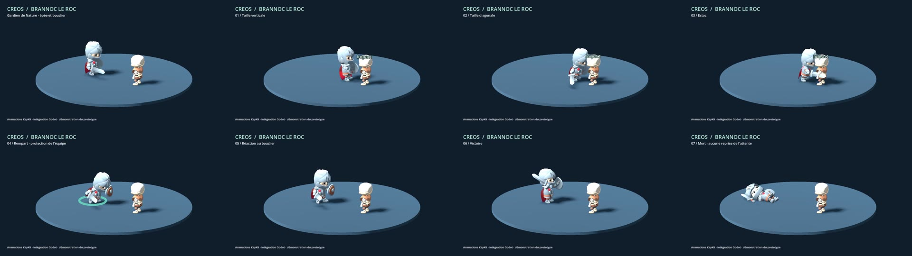

# Animations — pilote Brannoc

Brannoc utilise le modèle Knight et les animations KayKit déjà présents dans le dépôt.
Cette première passe améliore leur intégration ; elle ne crée pas de nouveau modèle ni de
mouvements par capture vidéo. Les autres héros gardent leur équipement et leurs gestes actuels.



[Voir ou télécharger la démonstration de 15 secondes](brannoc-preview.mp4).

## Voir la démonstration dans Godot

Depuis la racine du projet :

```bash
godot --path . --script res://tools/preview_brannoc.gd
```

La séquence montre trois attaques avec approche et retour, Rempart, une réaction au bouclier,
la victoire et la mort. Fermer la fenêtre pour quitter. Pour enregistrer une vidéo :

```bash
godot --path . --script res://tools/preview_brannoc.gd --write-movie brannoc.avi --fixed-fps 30 --quit-after 450
```

## Ce qui change en combat

- Épée à une main et bouclier rond visibles ; les équipements alternatifs sont masqués.
- Alternance déterministe entre taille verticale, diagonale et estoc.
- Course vers la position de la cible, puis retour en marche arrière et orientation restaurée.
- Rempart sur place, avec une onde verte au moment de l'effet de bouclier sur Brannoc.
- Les coups reçus ne coupent plus une action en cours. La mort annule le déplacement et reste définitive.
- Les dégâts, soins et morts s'affichent au moment prévu de l'impact. La victoire attend la fin
  des gestes ; une relance efface les effets en attente.

La synchronisation des effets et la protection des actions s'appliquent aussi aux autres unités.
Le moteur continue de simuler normalement : aucune statistique, formule de dégâts ou règle de
ciblage ne change. Les PV affichés utilisent les événements différés ; l'énergie et les états
restent ceux de la simulation. Les événements simultanés gardent leur ordre logique.

## Régler un héros

Les paramètres restent dans `data/heroes.json` :

| Champ | Rôle |
|---|---|
| `equipment_nodes` / `show` | Équipements à filtrer / ceux à rendre visibles |
| `anim.attacks` | Liste de variantes alternées, facultative |
| `anim.run`, `anim.return`, `anim.hit`, `anim.victory` | Clips supplémentaires, facultatifs |
| `presentation.advance` | Activer l'approche pour l'attaque de base |
| `approach_duration`, `return_duration`, `reach` | Durées de déplacement et distance à la cible |
| `action_duration` | Durée du geste, indépendante de la longueur du clip importé |
| `impact_ratio`, `skill_impact_ratio` | Moment d'impact entre 0 et 1 dans le geste |
| `blend` | Fondu entre les animations |
| `shield_color` | Couleur de l'onde de protection |

Sans profil, une unité conserve son attaque définie par `anim.attack`, sans déplacement.
Un clip absent utilise l'attaque habituelle, puis `Idle` en dernier recours. Les boucles sont
modifiées dans des bibliothèques locales à chaque instance, sans altérer les modèles partagés.

## Vérifications

```bash
godot --headless --path . --import
godot --headless --path . --script res://tests/run_tests.gd
godot --headless --path . --script res://tests/smoke_battle.gd --fixed-fps 60
godot --headless --path . --script res://tests/test_animation_presentation.gd --fixed-fps 60
```

Validé dans l'environnement de travail avec Godot **4.6.3** (la cible du projet est 4.7) :
13 vérifications du moteur, 45 vérifications d'animation et un combat complet jusqu'à l'écran
final. Démonstration rendue en 1280 × 720, OpenGL Compatibility, à 30 images/s.
Le rendu Mobile/Vulkan et les appareils Android/iOS restent à vérifier sur leurs plateformes.

## Pour les prochains héros

Reprendre ce profil après avoir vérifié leurs équipements, la portée et les moments de contact.
Pour des gestes originaux : retoucher les squelettes et les animations dans Blender, exporter en
GLB, puis vérifier les noms de clips dans Godot. Une vidéo peut servir de référence de mouvement ;
une capture automatique doit encore être adaptée au squelette et nettoyée.
