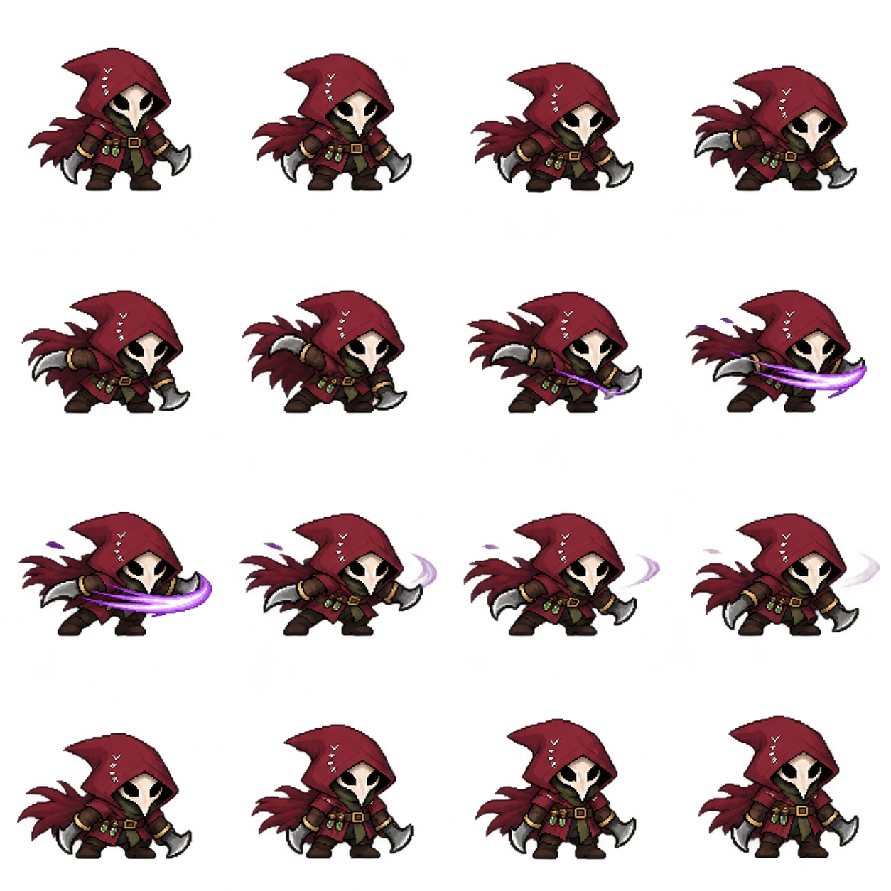
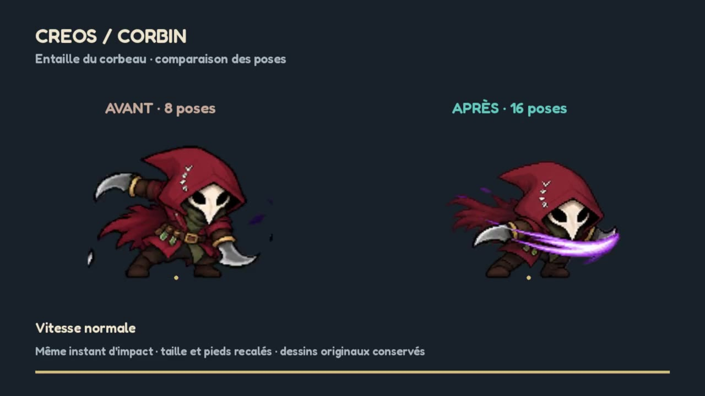

# Corbin — attaque de base en 16 poses

Base de travail : branche `claude/etape1-hub-progression`, révision `ff6b4748`.
Il s'agit bien de la version 2D actuelle : 19 héros, personnages pixel, décors et salles peints.

## Première passe

L'attaque de base de Corbin passe de **8 à 16 dessins**, avec anticipation, taille vers la droite,
traînée violette et retour à la garde. La planche a été créée avec le générateur d'images de
ChatGPT en prenant les sprites de Corbin comme références. Il ne s'agit pas de copies répétées
pour augmenter artificiellement le nombre d'images.



Les huit PNG d'origine restent présents et leur animation est conservée sous
`attack_1_original`. Seule l'attaque `attack_1` est remplacée dans cette première passe ; les
18 autres héros et les autres mouvements de Corbin restent à travailler individuellement.
Le nombre d'images ne garantit pas, à lui seul, une animation parfaite : cette version sert
à examiner le style, le rythme et les poses avant de préparer les autres planches.

## Voir le mouvement

```bash
godot --path . --script res://tools/preview_pixel_animation.gd
```

[Voir le comparatif vidéo (9 secondes)](corbin-comparaison.mp4).



Le comparatif montre les deux attaques au même instant, d'abord à vitesse normale, puis au
ralenti. Le repère au sol permet de vérifier le calage. La bande dorée indique l'impact du
clip de combat (`corbin_0`, à 0,702 seconde).

Pour enregistrer une comparaison :

```bash
godot --path . --script res://tools/preview_pixel_animation.gd --write-movie comparaison.avi --fixed-fps 30 --quit-after 270
```

## Intégration dans le jeu

`PixelSheet` lit maintenant des régions d'atlas, en plus du format historique (un PNG par
pose). Chaque pose possède son ancre et son échelle. `ClipPlayer` utilise le calage de l'image
réellement affichée, y compris lorsqu'il revient aux anciens dessins de repos.

Les pieds sont recalés à partir des pixels opaques des dernières lignes ; une échelle commune
conserve la hauteur de la première pose. Les variations de hauteur pendant l'attaque restent
naturelles : chaque image n'est pas étirée indépendamment. La planche reste intacte, sans
redimensionnement ni rééchantillonnage de ses pixels.

Le repère de frappe de la nouvelle animation est l'image 8 (neuvième image, indices à partir
de zéro). La logique d'étirement existante le synchronise avec le clip. Aucun changement des
statistiques, dégâts, effets ou règles de combat.

## Importer une autre planche

```bash
python tools/import_pixel_atlas.py corbin attack_1 chemin/planche.png --columns 4 --frames 16 --hit-frame 8
```

L'outil accepte une grille régulière et garde l'ancienne animation. Il mesure seulement l'alpha
pour calculer le calage, copie le PNG intact et met à jour `sheet.json`. Il nécessite Pillow,
comme les autres outils d'import du projet. Les durées peuvent ensuite être réglées dans
`sheet.json` ; chaque entrée contient le fichier, la durée en secondes, puis sa région,
son ancre et son échelle. Les cases ne doivent contenir ni chiffres ni traits de grille.

## Outils pour continuer

- **Aseprite** : retouches pixel par pixel, pelure d'oignon, contrôle des silhouettes et du
  rythme, export d'une grille PNG. Adapté à ces personnages pixel.
- **LibreSprite** : alternative libre pour retoucher les images.
- **Godot** : contrôle du mouvement dans le jeu, des pieds et de la synchronisation des impacts.
- **Générateur d'images ChatGPT** : première production de poses à partir des références du héros,
  suivie d'une vérification des mains, armes, proportions et marges. Une vidéo générée n'est pas
  directement une planche exploitable : elle exige une extraction, un calage et des retouches.

Les 19 héros disposent actuellement de huit poses par animation principale. La suite demande
une planche cohérente par mouvement et par personnage, plutôt qu'un changement global de vitesse.

## Vérifications effectuées

- 76 vérifications atlas : limites des cases, pieds, taille initiale, impact, retour au repos,
  conservation de la mort et compatibilité des autres héros.
- 175 vérifications existantes du moteur et de la progression.
- Tests de fumée du combat et du hub terminés avec un code de sortie 0.
- Comparaison reproductible avant/après, graine 42 : victoire en 29,7 secondes de simulation
  dans les deux versions.
- Comparatif vidéo et captures de la vraie scène de combat contrôlés.

Exécuté avec Godot 4.6.3, disponible dans l'environnement ; le projet vise Godot 4.7.
Aperçu rendu en OpenGL Compatibility. La vérification sur téléphone reste à faire.
Les tests existants signalent encore des ressources conservées à la fermeture et, selon le
combat, un callback dont la cible a été supprimée ; ces messages se produisent aussi sur la
version de base, sans le pilote.
